# Gym Tracker

Plain HTML + CSS + vanilla JS (ES modules, no build step), hosted on Fly.io, with Supabase for accounts and data.
The full design is in `gym-tracker-plan.md`; the original mockup is `gym tracker example.html`.

## Screenshots

| Dashboard | Cartoon theme |
| --- | --- |
| 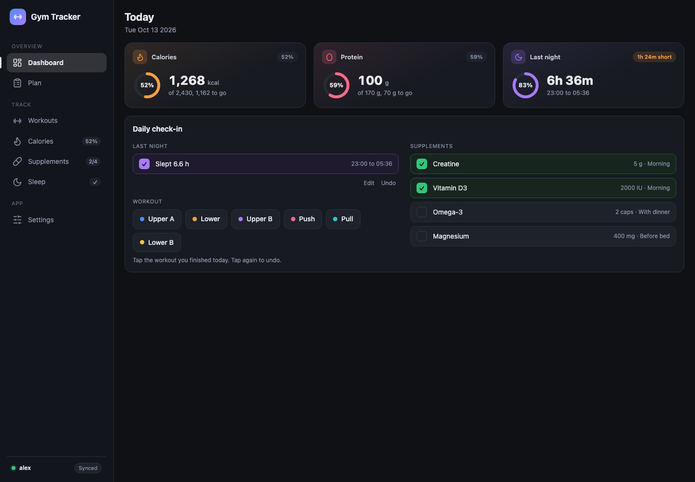 | 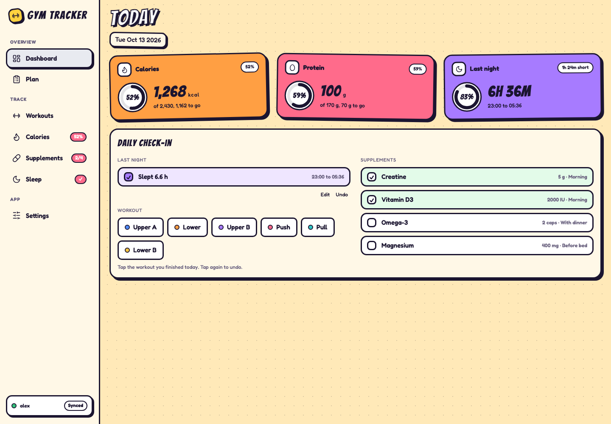 |
| **Workouts** | **Plan** |
| 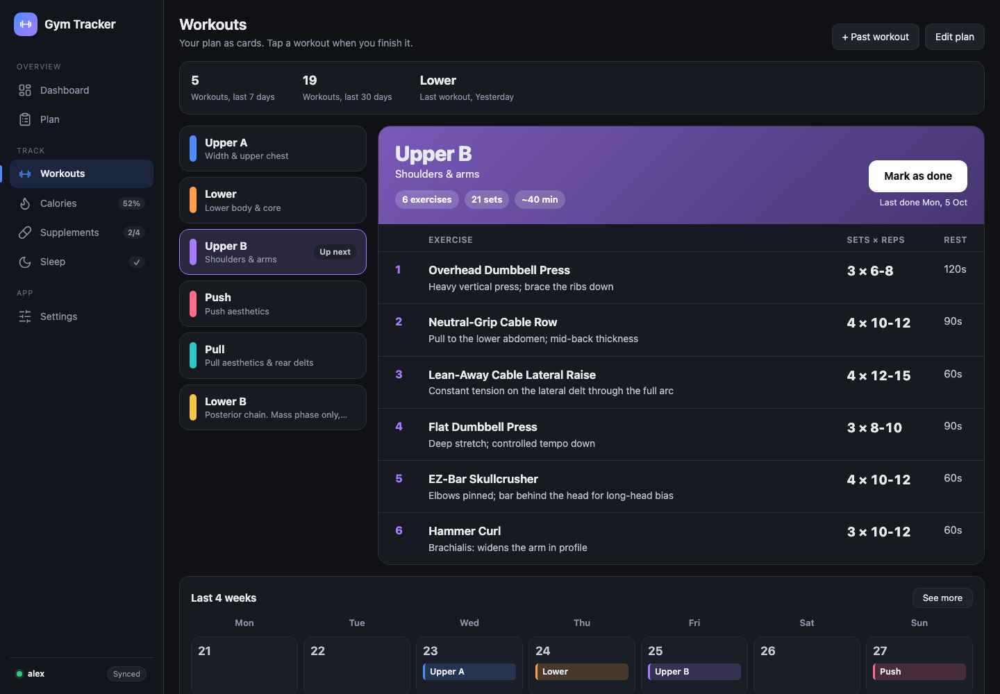 | 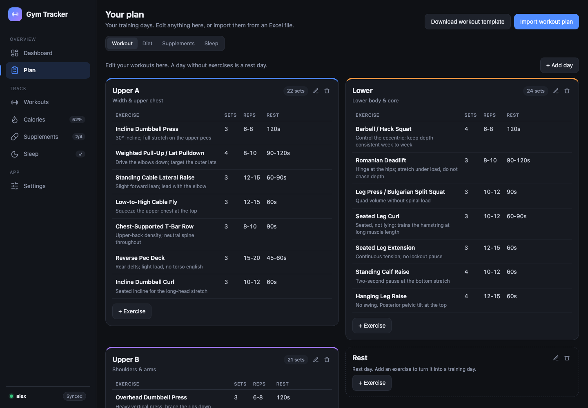 |
| **Supplements** | **Sleep** |
| 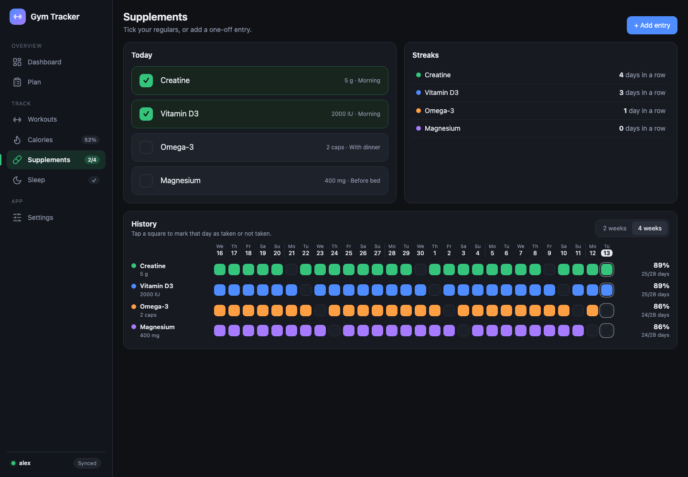 | 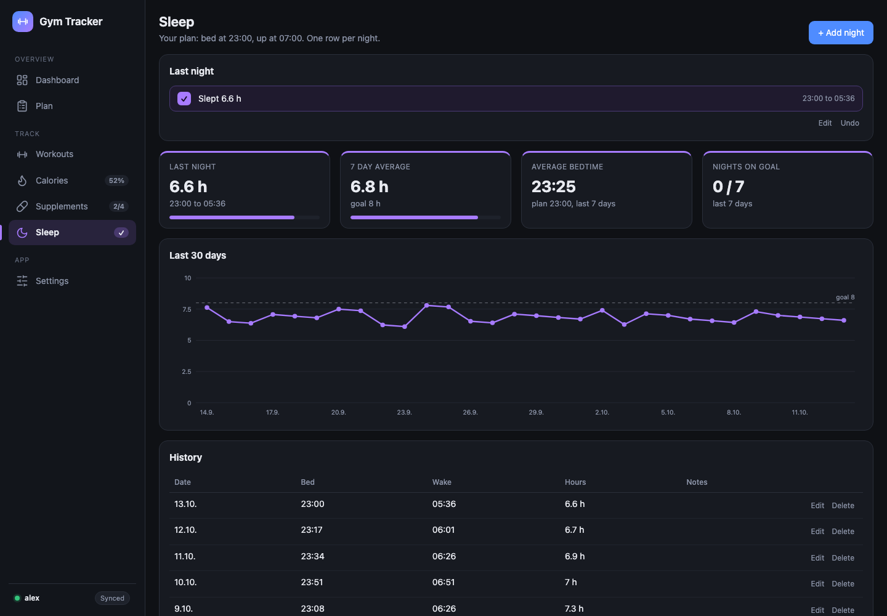 |
| **Calories** | **Settings** |
| 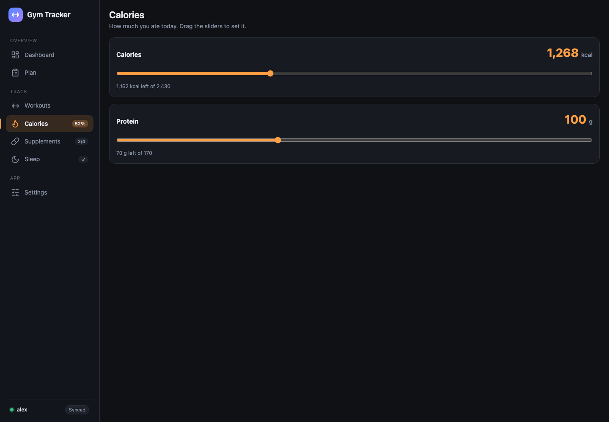 | 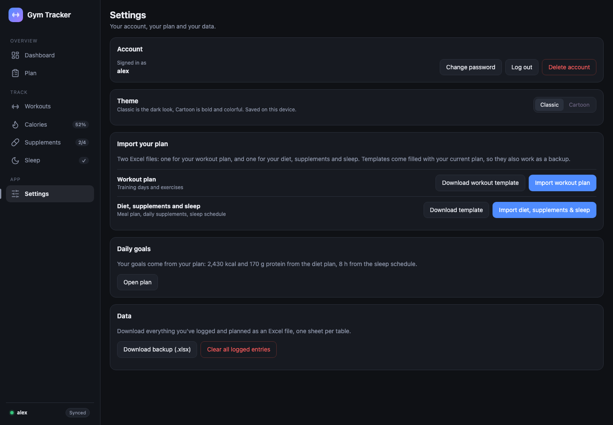 |

On a phone the sidebar becomes a bottom bar:

  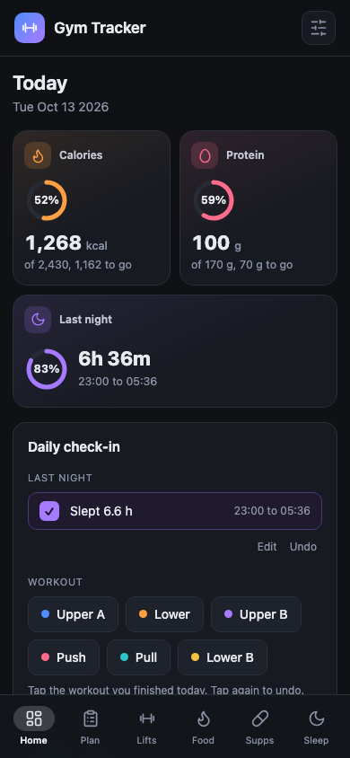
  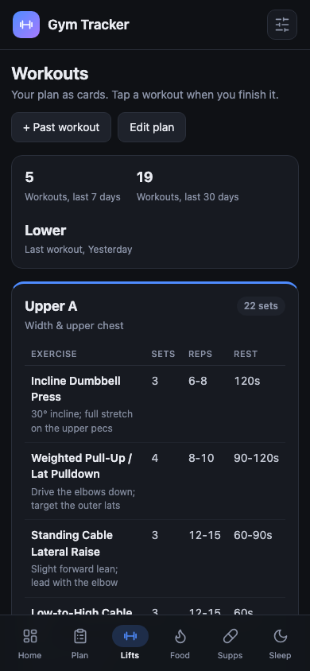

People log in with a username and password:

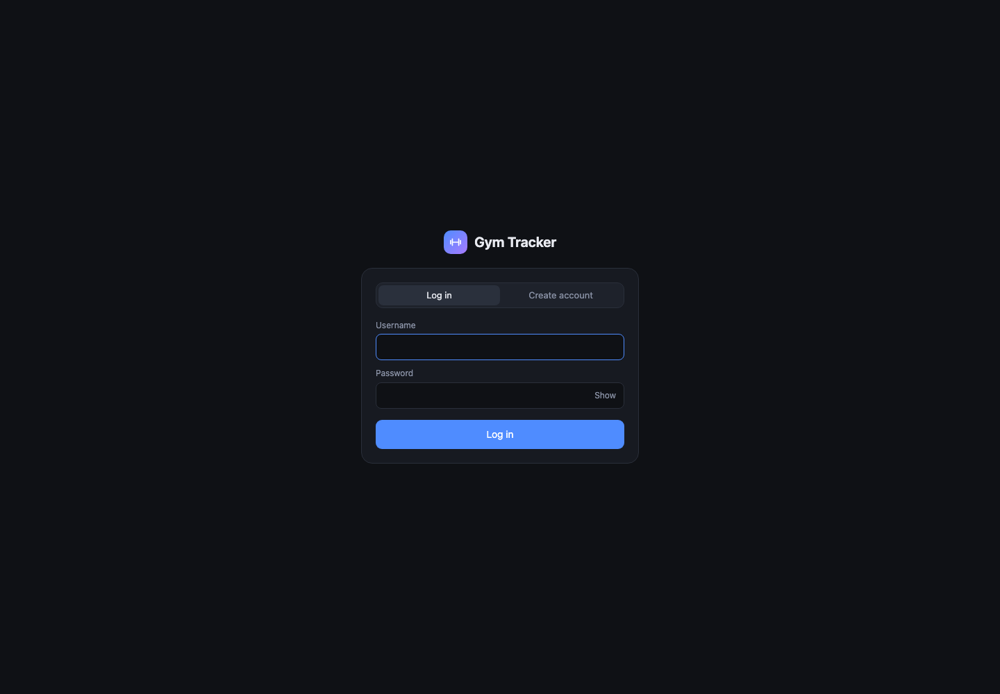

## Setup

1. **Supabase:** create a project, run `supabase/schema.sql` in the SQL Editor, and apply the Auth settings
   from section 3.4 of the plan (email provider on, **Confirm email off**, minimum password length 8).
   People log in with a username and password; there are no emails or password reset links.
   A database created from an older `schema.sql` also needs `supabase/002_progressive_overload.sql`
   (per-set reps and weights, and the weight increase after each finished workout).
2. **Config:** put the Project URL and the anon / publishable key in `public/config.js`.
   Never put the service_role / secret key there. Usernames are stored in Supabase as
   `<username>@<usernameDomain>`; if Supabase says that address is invalid, set `usernameDomain` to a domain you own.
   Forgotten password: reset it yourself in Supabase under Authentication, Users.
3. **Run locally:** `python3 -m http.server 8080 -d public`, then open http://localhost:8080.

## Deploy (Fly.io)

1. Change `app` in `fly.toml` to a unique name.
2. `fly launch --no-deploy` (keep the existing fly.toml), then `fly deploy`, then `fly scale count 1`.
3. Add `https://<app>.fly.dev` to Supabase as the Site URL.
4. For the keep-alive workflow, add `SUPABASE_URL` and `SUPABASE_KEY` (the public key) as GitHub secrets.

## Layout

- `public/app.js`: startup, auth state, routing, navigation
- `public/js/auth.js`: username sign up and log in, log out, change password, delete account
- `public/js/db.js`: every Supabase read and write; `outbox.js` queues writes while offline;
  `cache.js` keeps a per-account local copy; `sync.js` loads data
- `public/js/actions.js`: what each tap does (screen first, then the write)
- `public/js/import.js`: Excel import, templates, backup download
- `public/js/views/*`, `public/js/ui/*`: pages and shared pieces
